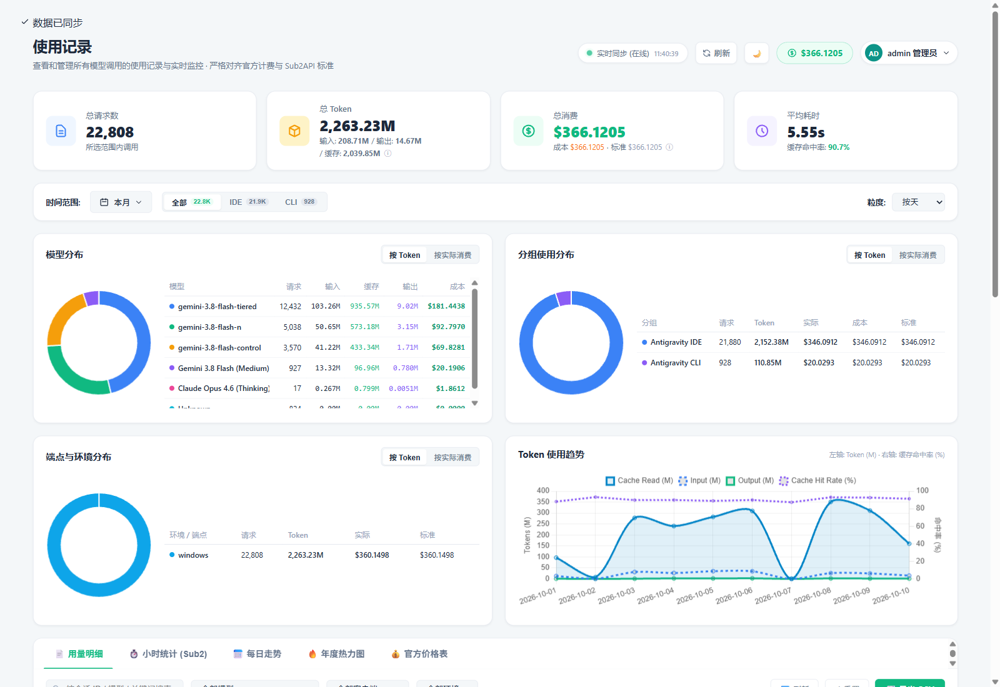
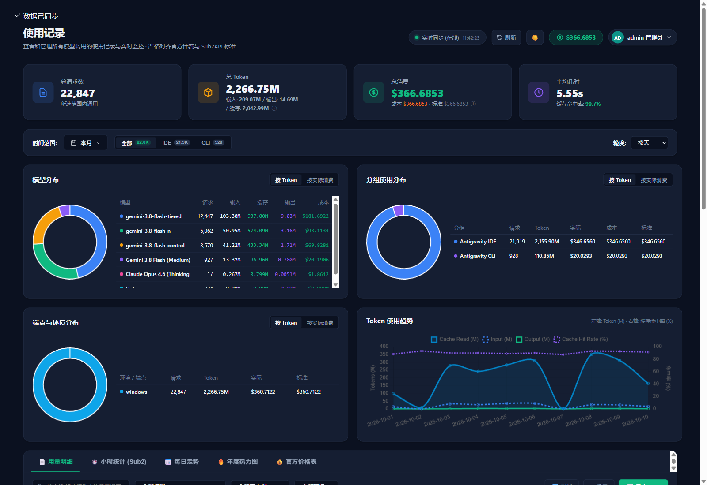

# 📊 Oh My AGY Token (oh-my-agytoken)

<p align="center">
  <b>High-Performance Local Token Statistics, Real-Time Monitoring & Enterprise Interactive Analytics Dashboard for Google Antigravity</b>
</p>

<p align="center">
  <a href="https://github.com/jgahj/oh-my-agytoken/stargazers"></a>
  <a href="https://github.com/jgahj/oh-my-agytoken/network/members"></a>
  
  
  
  <a href="LICENSE"></a>
</p>

<p align="center">
  <a href="README.md">简体中文</a> | <b>English</b>
</p>

---

## 📖 Introduction

**Oh My AGY Token** (`oh-my-agytoken`) is a high-performance, lightweight, zero-dependency token analytics and live monitoring tool crafted for **Google Antigravity** (both Antigravity IDE & Antigravity CLI).

It automatically discovers local conversation databases across Windows and WSL2 environments, decodes low-level Protobuf binary wire streams natively using pure Python, and extracts model tokens, Thinking Tokens (Chain-of-Thought), Prompt Caching hit rates, and request latencies. It also delivers a **sub-second real-time sync service**, **Sub2API official price calculation**, and an **interactive enterprise-grade single-file HTML dashboard**.

---

## 📸 Real Interactive Dashboard Preview

The dashboard uses a single-file self-contained architecture with complete offline rendering, persistent theme memory, and enterprise SaaS design aesthetics (similar to Linear / Vercel design systems):

### 1. ☀️ Modern Light Theme (Default)
Clean white and soft-slate card design with crisp typography, ideal for daytime productivity:



### 2. 🌙 Geek Dark Theme (Optional)
Deep Slate dark tones with vibrant tech accents and adaptive high-contrast chart palettes:



### ✨ Core Features & Architectural Layout
- **⚡ Sub-Second Live Sync & Active WAL Tracking**:
  - Top live indicator pill with breathing animation and dynamic sync timestamps.
  - Senses SQLite database and `-wal` write-ahead log updates; automatically refreshes token statistics as you code and chat.
- **📊 Top 4 KPI Metric Cards**:
  - **Total Requests**: Quantifies model invocations in selected range.
  - **Total Tokens (M Units)**: High-level total alongside three-way breakdown: `Input (Uncached)`, `Output (Generated)`, and `Cache Read`.
  - **Total Expenditure**: Aligned with Sub2API pricing, comparing actual expenditure, catalog standard pricing, and upstream cost, plus Prompt Caching savings.
  - **Average Latency & Cache Hit Rate**: Highlights mean response time and context cache hit rate (often 90%+).
- **🎛️ Global Advanced Filter Bar**:
  - **Date Range Popover**: 9 preset quick filters (`Today`, `Yesterday`, `Last 24h`, `Last 7d`, `Last 14d`, `Last 30d`, `This Month`, `Last Month`, `All Time`) plus custom date pickers.
  - **Client Dimension Pills**: `All`, `Antigravity IDE`, `Antigravity CLI` with invocation count badges; triggers real-time full-page synchronized filtering.
  - **Granularity Selector**: Toggle between `Hourly`, `Daily`, and `Monthly`.
- **📈 2x2 Core Analytics Chart Grid**:
  - **Model Distribution**: Donut chart + mini data table (toggle between `By Tokens` and `By Actual Cost`).
  - **Client Group Distribution**: Donut chart comparing IDE vs CLI usage and cost.
  - **Endpoint & Environment Distribution**: Donut chart comparing Windows Local vs WSL2 environments.
  - **Token Usage Trend**: Dual Y-axis area & line chart tracking token types on left axis and cache hit rate on right axis.
- **📑 Bottom 5 Multi-Functional Tabs**:
  - **Tab 1: 📄 Usage Details**: Keyword search, multi-field dropdown filters, CSV export, and an 11-column high-precision invocation log (second-level timestamps, copyable UUIDs, client badges, latency color bars, token composition, cost/savings, and detailed inspect modal).
  - **Tab 2: ⏱️ Hourly Analysis (Sub2)**: Hourly stacked bar charts (stacked by type or model) and 24-hour breakdown table.
  - **Tab 3: 📅 Daily Trends**: Daily token consumption bar/line charts and daily expenditure/savings tables.
  - **Tab 4: 🔥 Annual Contribution Heatmap (GitHub-style)**: 52-week 365-day SVG activity heatmap with hover tooltips displaying daily usage.
  - **Tab 5: 💰 Official Pricing Sheet**: Full tier-rate comparison for Gemini 3.1 Pro, Gemini 3.8/3.7/3.6 Flash, Flash-Lite, and Claude Opus 4.6.
- **📦 Zero External Dependencies**: 100% built on Python 3.8+ standard libraries—no `pip install` required.

---

## 🚀 Quick Start & Usage Guide

### 1. Requirements
- **OS**: Windows 10 / 11, Linux (including WSL2), or macOS
- **Python**: Python 3.8+ (Python 3.10 ~ 3.14 recommended, supports system `python` or `uv`)
- **Dependencies**: **Zero external dependencies**!

---

### 2. How to Run

#### Option A: Windows One-Click Launcher (Recommended)
Simply double-click **`run_stats.bat`** in the repository root:
1. Automatically detects Python 3.14/3.12 or the default system Python;
2. Configures Windows console UTF-8 (CP65001) encoding;
3. Scans all conversation databases and generates updated reports;
4. **Starts the local live server (default port: 8765) and opens your default browser**;
5. **Live Monitoring**: Keep the terminal window open; new conversations and token consumption in Antigravity will automatically sync to your dashboard within seconds!

> 💡 Tip: Press `Ctrl + C` anytime to safely stop the monitoring server.

---

#### Option B: Command Line Interface
Open your terminal in the project directory and run:

```bash
# Standard run (starts live server and launches dashboard)
python export_report.py

# Or with uv
uv run export_report.py
```

---

### 3. Command Line Options

`export_report.py` provides versatile CLI options for automation and custom setups:

| Flag | Short | Default | Description |
| :--- | :---: | :---: | :--- |
| `--once` / `--export-only` / `--no-server` | `-1` | No | **Export Only**: Generates static HTML and Markdown without keeping the background server alive |
| `--no-cache` / `--force-refresh` | `-f` | No | **Force Full Rescan**: Bypasses local incremental cache and re-parses all historical databases |
| `--no-browser` | `-n` | No | **Silent Mode**: Exports reports without automatically opening the browser |
| `--port <port>` | `--port=8765` | `8765` | **Custom Port**: Specifies the HTTP port for the live monitoring server |

#### Usage Examples:

```bash
# 1. Export static reports once and exit immediately
python export_report.py --once

# 2. Force full rescan without cache and launch dashboard
python export_report.py -f

# 3. Run server on port 8888 in headless mode (no browser pop-up)
python export_report.py --port 8888 -n

# 4. Quick terminal-only summary report
python token_analyzer.py
```

---

## 📁 Output Files

Running the tool produces the following output files in the root folder:

| File | Format | Purpose |
| :--- | :---: | :--- |
| **`Antigravity_Token_Dashboard.html`** | HTML | **Interactive Enterprise-Grade Dashboard**. Fully self-contained, offline-compatible visualization dashboard. |
| **`Antigravity_Token_Report.md`** | Markdown | **Structured Deep Analytics Report**. Detailed summary, top 20 conversations by consumption, and prompt breakdowns. |
| **`token_records_detailed.csv`** | CSV | **Per-Request Detailed Record**. Granular log of every call (timestamps, model, uncached input, cached read, output, thinking tokens, latency). |
| **`token_stats_summary.json`** | JSON | **Aggregated Statistical Data**. Structured multi-dimensional JSON metrics. |
| **`.token_cache.json`** | JSON | **Incremental Cache Fingerprint** (ignored by git). Accelerates scans by skipping unchanged DBs. |

---

## 💰 Pricing & Cost Engine

Implemented in `pricing.py`, strictly aligned with Google official pricing and **Sub2API** configurations:

- **Gemini 3.1 Pro**:
  - Context $\le$ 200k: Input \$2.00 / 1M, Output \$12.00 / 1M, Cache Read \$0.20 / 1M
  - Context $>$ 200k: Input \$4.00 / 1M, Output \$18.00 / 1M, Cache Read \$0.40 / 1M
- **Gemini 3.8 / 3.7 / 3.6 Flash**: Input \$0.75 / 1M, Output \$3.75 / 1M, Cache Read \$0.075 / 1M
- **Gemini 3.5 Flash-Lite**: Input \$0.30 / 1M, Output \$2.50 / 1M, Cache Read \$0.03 / 1M
- **Gemini 3.1 Flash-Lite**: Input \$0.25 / 1M, Output \$1.50 / 1M, Cache Read \$0.025 / 1M
- **Gemini 2.5 Flash-Lite**: Input \$0.10 / 1M, Output \$0.40 / 1M, Cache Read \$0.01 / 1M
- **Claude Opus 4.6 (Thinking)**: Input \$5.00 / 1M, Output \$25.00 / 1M, Cache Read \$0.50 / 1M

The engine computes not only actual expenditure, but also exact savings gained through **Prompt Caching**!

---

## ⚙️ Architecture & Implementation

```text
  ┌─────────────────────────────────────────────────────────────┐
  │         1. Adaptive Cross-Platform / Machine Discovery      │
  │   Windows: C:\Users\*\.gemini\antigravity-ide\conversations │
  │   WSL2:    Sub-millisecond Registry discovery + UNC paths   │
  └──────────────────────────────┬──────────────────────────────┘
                                 │
                                 ▼
  ┌─────────────────────────────────────────────────────────────┐
  │         2. Lock-Free SQLite Read-Only Access (I/O Safe)     │
  │         URI: file:{db_path}?mode=ro                         │
  │         - Zero lock contention with active Antigravity IDE  │
  │         - Maps step execution timestamps to gen_metadata    │
  └──────────────────────────────┬──────────────────────────────┘
                                 │
                                 ▼
  ┌─────────────────────────────────────────────────────────────┐
  │         3. Native Python Protobuf Binary Wire Decoder       │
  │   Parses raw binary blobs in the `gen_metadata` table       │
  │   - Wire Type 0 (Varint) / Wire Type 2 (Length-delimited)   │
  │   - Zero .proto compilation; extracts tokens & metadata     │
  └──────────────────────────────┬──────────────────────────────┘
                                 │
                                 ▼
  ┌─────────────────────────────────────────────────────────────┐
  │    4. ⚡ Dual-Fingerprint Cache & WAL Activity Tracking      │
  │   - Verifies composite (mtime, size) of main DB and WAL     │
  │   - Instant millisecond cache hit; 15x+ speedup             │
  └──────────────────────────────┬──────────────────────────────┘
                                 │
                                 ▼
  ┌─────────────────────────────────────────────────────────────┐
  │    5. Multi-Dimensional Aggregation, Live Sync & Dashboard  │
  │   Renders HTML/Markdown reports & provides live HTTP polling│
  └─────────────────────────────────────────────────────────────┘
```

---

## 📂 Project Structure

```text
oh-my-agytoken/
├── pricing.py                     # Pricing engine & cost calculations (Sub2API aligned)
├── proto_decoder.py              # Pure Python Protobuf binary wire decoder
├── token_analyzer.py             # Discovery scanner, SQLite access & cache fingerprints
├── export_report.py              # Aggregation, report rendering & live HTTP server
├── run_stats.bat                 # One-click Windows runner for live monitoring & UI
├── Antigravity_Token_Dashboard.html # High-performance interactive dashboard (single-file)
├── Antigravity_Token_Report.md   # Detailed Markdown analytics report
├── assets/                       # Dashboard preview screenshots (actual UI captures)
│   ├── dashboard_preview.png     # Modern light theme screenshot
│   └── dashboard_preview_dark.png # Geek dark theme screenshot
├── .gitignore                    # Excludes sensitive database caches and details
├── LICENSE                       # MIT License
├── README.md                     # Chinese documentation
└── README_EN.md                  # English documentation
```

---

## 📄 License

This project is licensed under the [MIT License](LICENSE).
